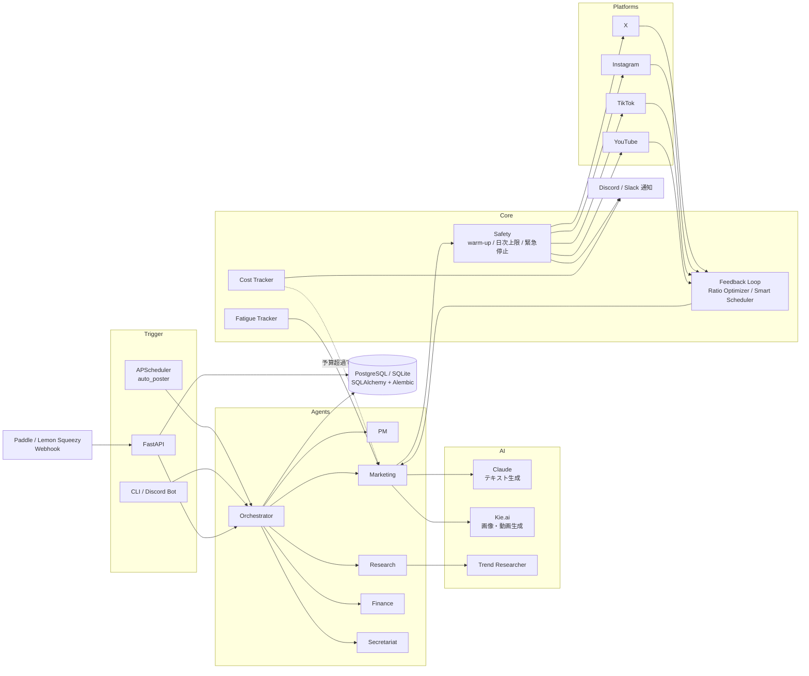

# SNS Automation — AI駆動のSNS自動運用・収益化システム

[](https://github.com/ten-ten66/sns-automation/actions/workflows/ci.yml)

> 本プロジェクトは **Claude Code を用いたAI駆動開発** で設計・実装しました。

美容・スキンケア（J-beauty）アカウントの運用を想定し、Claude（Anthropic API）でコンテンツを生成して、X / Instagram / TikTok / YouTube への投稿・分析・収益化までを自動で回す Python 製のバックエンドです。
部門ごとの AI エージェント（PM・リサーチ・マーケティング・財務・秘書）を Orchestrator が束ね、投稿スケジュール・コスト管理・BAN 回避を一元的に扱います。

※ 公開版では X のエンゲージメント自動化モジュール（`src/growth/x_growth.py` 等）を除外しています。

## 構成図



## 技術スタック

| 分類 | 使用技術 |
|---|---|
| 言語 | Python 3.11+ |
| Web / API | FastAPI, Uvicorn, slowapi（レート制限）, Jinja2 |
| DB | SQLAlchemy 2.0（async）, Alembic, PostgreSQL / SQLite |
| AI | Anthropic Claude API, Kie.ai（画像: Nano Banana / 動画: VEO 3.1） |
| SNS | tweepy, instagrapi, Google API Client（YouTube）, TikTok API |
| スケジューラ | APScheduler |
| Bot / 通知 | discord.py, Discord / Slack Webhook |
| 画像処理 | Pillow, OpenCV（顔モザイク） |
| インフラ | Docker / docker-compose, GitHub Actions（pytest） |

## 主な機能

- **マルチエージェント構成**：PM / Research / Marketing / Finance / Secretariat の各エージェントを Orchestrator がディスパッチし、実行ログを `agent_logs` に必ず記録
- **コンテンツ自動生成**：Claude による投稿文生成、Kie.ai による画像・動画生成、トレンド調査に基づくネタ出し
- **マルチプラットフォーム投稿**：X / Instagram / TikTok / YouTube を共通インターフェース（`platforms/base.py`）で抽象化
- **占いコンテンツ API**：タロット・星座・数秘術などを生成する公開エンドポイント（AI 生成であることを明示）
- **決済 Webhook**：Paddle / Lemon Squeezy の HMAC 署名を検証し、顧客・注文・サブスクリプションを DB に反映
- **Discord Bot**：スラッシュコマンドから画像・動画生成や SNS 管理を操作
- **アフィリエイトリンクの自動挿入**、収益・ROI の集計
- **Web ダッシュボード**：投稿生成・スケジュール・分析・SEO 最適化をブラウザから操作

## 工夫した点

- **BAN 回避の安全装置**（`core/safety.py`）：新規アカウントの warm-up、プラットフォーム別の日次上限、シャドウバン検知、ジッター付き投稿間隔、重複投稿検知、緊急停止を1か所に集約
- **API コストのガードレール**（`core/cost_tracker.py`）：Claude のトークン数・Kie.ai の生成回数から USD 換算で使用量を追跡し、予算超過時はジョブを自動スキップ
- **フィードバックループ**：エンゲージメント実績から投稿タイプの比率（`ratio_optimizer`）と投稿時刻（`smart_scheduler`）を自動調整し、`fatigue_tracker` で同じパターンの使い回しを防止
- **リスクのある話題の除外**：訃報・災害・事件などのトレンドには便乗しない正規表現フィルタ
- **生成画像の顔モザイク**：プロンプト設計で顔を出さないうえで、後処理の顔検出モザイクを「第三の防御線」として実装
- **ステマ規制・FTC への対応**：PR 投稿は先頭に【PR】を必ず付け、効果効能の断定表現をプロンプトとテストの両方で禁止
- **プラットフォームごとのコンテンツ制限チェック**：投稿前に禁止語・禁止トピックを検査し、該当すれば再生成
- **パストラバーサル対策**：投稿に添付するメディアは `data/media` 配下だけを許可（前方一致ではなく `Path.is_relative_to` で判定し、テストで隣接ディレクトリも検証）
- **可観測性を本処理より優先しない設計**：エージェントログの DB 書き込み失敗は警告にとどめ、本処理を止めない

## セットアップ

```bash
git clone https://github.com/ten-ten66/sns-automation.git
cd sns-automation
python3 -m venv venv && source venv/bin/activate
pip install -r requirements.txt

cp .env.example .env   # 各 API キーを設定（値は空で配布）
alembic upgrade head   # DB マイグレーション

# API サーバー
uvicorn src.api.app:app --host 127.0.0.1 --port 8000
# CLI
python -m src.cli --help
# テスト
pytest -q
```

Docker で動かす場合：

```bash
cp .env.example .env   # POSTGRES_PASSWORD などを設定
docker compose up -d
```

各サービスのアカウント準備・APIキー取得手順は [`SETUP_GUIDE.md`](SETUP_GUIDE.md) を参照してください。
